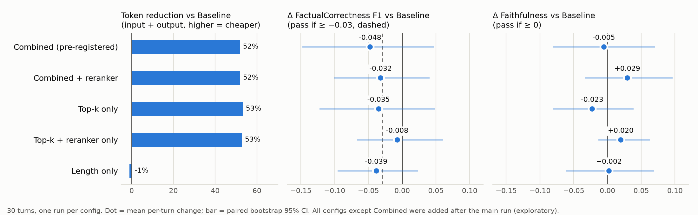

# Optimizing Token Usage in a RAG Knowledge Assistant (imec exercise, Part C)

A small proof of concept that compares a **baseline RAG agent** with a **token-optimized RAG agent**. The goal is to see whether token usage can drop without a significant loss in answer quality.

> **Status: complete.** The design sections below were written **before any runs**; deviations are marked. Results, lessons and limitations are at the end.

**Headline:** the pre-registered optimized agent (top-k 4 + response-length control) cut total tokens by **52%** and cost by **49%**, but **failed** the quality rules (FactualCorrectness F1 −0.048, Faithfulness −0.005). In exploratory follow-ups, **top-k filtering with a cross-encoder reranker, without length control**, cut tokens by **53%** and **passed** both rules (F1 −0.008, Faithfulness +0.020), at the cost of ~5.7 s of CPU reranking per question. With 30 turns and one run per config, all quality differences are within their 95% confidence intervals.

## Techniques under test

1. **Top-k filtering** (reduces input tokens): retrieve fewer passages per question. Baseline uses `k = 10` and the optimized agent uses `k = 4`.
2. **Response length and structure control** (reduces output tokens): set `max_tokens = 200` and use a system prompt that limits the answer to about 150 words, gives the direct answer first and the cited sources after it, and allows no filler.

## Experiment design

| | Baseline | Combined (optimized) |
|---|---|---|
| Top-k | 10 | 4 |
| `max_tokens` | 1024 (a ceiling answers should never reach) | 200 |
| System prompt | answer only from the context | same + constraints: at most 150 words, answer first, then one `Sources: [n]` line, no filler |

All configs are defined in [src/config.py](src/config.py).

**Follow-up config, added after the main run (not pre-registered):** `combined_rerank` is Combined plus a cross-encoder reranker (`BAAI/bge-reranker-base`). The embedding search returns 20 candidates, the reranker re-scores them, and the best 4 are kept. Motivation: in the main run most of Combined's quality loss came from turns where k=4 dropped the gold passage. Reranking costs no LLM tokens, but it adds local compute time, which is logged separately as `retrieval_latency_s`. Retrieval-only check: Recall@4 goes from 0.283 to 0.316 (15 → 16 of 30 turns with at least one gold passage), and the gold passage is recovered on both turns that were hurt most in the main run.

**Ablations (added after the main run):** each applies a single technique to the Baseline, so its effect can be measured in isolation:

| Config | Top-k | Reranker | `max_tokens` | Length constraints in prompt |
|---|---|---|---|---|
| `topk_only` | 4 | no | 1024 | no |
| `topk_rerank_only` | 4 (from top 20) | yes | 1024 | no |
| `length_only` | 10 | no | 200 | yes |

**Held constant across configs:** the same OpenAI model (`gpt-5.4-nano-2026-03-17`; `gpt-5.6-luna` was rejected because it does not support temperature 0), temperature 0, the same embedding model and index, the same conversation history for each turn, and the same retrieval query (MTRAG's standalone rewritten question).

**Prompt design note:** Part B proposed "exactly two sentences". It was loosened to "at most 150 words, answer first" before any runs, because MTRAG reference answers have a median of 89 words; a one-sentence answer would lose FactualCorrectness recall by construction rather than because of the technique.

**Dataset:** [MTRAG](https://github.com/IBM/mt-rag-benchmark), a human-written multi-turn RAG benchmark (`mtrag-human`, passage-level corpora).

- **Domain: Govt.** It is the smallest corpus by passage count (49,607 passages; MTRAG's own README swaps the Cloud/FiQA/Govt sizes, so these are counted from the files), and its policy-style pages are closest to an internal knowledge base.
- **Turns: 30**, sampled with `seed = 42` from the 201 Govt tasks labelled ANSWERABLE or PARTIAL. UNANSWERABLE and CONVERSATIONAL turns are excluded because they have no gold passages, so Recall@k and FactualCorrectness are undefined or meaningless for them.
- **Resulting sample** ([data/sample_govt.jsonl](data/sample_govt.jsonl)): 28 answerable and 2 partial turns from 15 conversations, at turn positions 1 to 8, with 1 to 9 gold passages each (78 in total, all present in the corpus).
- Each turn stores the question, the prior conversation history, MTRAG's standalone rewritten question, the reference answer and the gold passage IDs. Recreate it with `python src/prepare_data.py sample`.

**Retriever:** `BAAI/bge-small-en-v1.5` embeddings (normalized, bge query prefix) with an exact FAISS inner-product index over the **full** Govt corpus, so no distractor subset is needed. Building it took 74 min on CPU (`python src/retriever.py build`); the index is git-ignored.

**Index sanity check** (`python src/retriever.py check`, retrieval only, no LLM, querying with the rewritten question):

| | Recall@k | Turns with ≥1 gold passage retrieved |
|---|---|---|
| k = 4 (Combined) | 0.283 | 15 / 30 |
| k = 10 (Baseline) | 0.425 | 20 / 30 |
| k = 20 | 0.529 | 20 / 30 |
| k = 4, reranked from top 20 | 0.316 | 16 / 30 |

### Metrics

| Metric | What it tells us |
|---|---|
| Input / output tokens per turn | the main target (taken from the API `usage` field) |
| Cost | tokens × provider price (`gpt-5.4-nano`: $0.20 / $0.02 / $1.25 per 1M input / cached input / output tokens), reported per 1,000 questions |
| Latency | wall-clock time of the LLM call; retrieval time is logged separately |
| Recall@k | whether the gold passage(s) are still retrieved at the lower k |
| Truncation rate | share of answers with `finish_reason = length` |
| RAGAS Faithfulness | whether the answer is supported by the retrieved context |
| RAGAS FactualCorrectness (F1) | whether the answer agrees with the MTRAG reference answer; **the pass/fail metric** |
| FactualCorrectness precision | share of the answer's claims that the reference supports (*diagnostic only*: a drop means the agent says wrong things) |
| FactualCorrectness recall | share of the reference's claims that the answer covers (*diagnostic only*: a drop means the agent says less) |

**Judge:** RAGAS 0.4.3 with `gpt-4.1-mini` at temperature 0 (non-reasoning, and a different model from the agent). The retrieval question given to Faithfulness is the standalone rewritten question, because the judge does not see the conversation history.

RAGAS scores only the **answer part** of each response, not the cited-sources line. An **empty answer** (blank, or nothing left after removing the Sources line) is not sent to the judge and scores **0** on every quality metric, so it counts as a failure rather than being dropped. Precision, recall and F1 are computed from a **single judge pass** per answer (one claim decomposition and verification, three numbers derived from it with RAGAS's own formulas), not from three separate RAGAS runs, so the three are consistent with each other.

### Pass/fail rules (fixed before running)

Let Δ = mean(Combined) − mean(Baseline), and let *noise* be the absolute difference between two identical Baseline runs on the same metric.

The optimized agent **passes** if both of these hold:

1. **FactualCorrectness (F1):** Δ ≥ −0.03, **or** |Δ| ≤ noise.
2. **Faithfulness:** Δ ≥ 0, **or** |Δ| ≤ noise.

In other words, a drop only counts as real degradation if it is larger than the run-to-run noise. FactualCorrectness precision and recall are reported next to F1 to explain *why* F1 moved, but they do not enter the verdict. Turns where an optimized config scores lower than Baseline are labelled with a cause: *gold passage lost* (Recall@k), *truncated* (`finish_reason = length`), or *detail dropped* (shorter answer).

> **Deviation from this plan:** Baseline was run **once**, not twice, so the run-to-run noise was not measured and the "|Δ| ≤ noise" clauses cannot be applied. The verdict therefore uses the fixed thresholds only (F1: Δ ≥ −0.03; Faithfulness: Δ ≥ 0). As a substitute indication of uncertainty, a paired bootstrap 95% confidence interval of the per-turn Δ is reported. Noise is real here: in the smoke test, 0 of 10 repeated answers were identical despite temperature 0.

### Validation

- **Smoke test:** the first 5 turns of the sample for Baseline and Combined (10 calls), read by hand before the full run. All answers were sensible; it surfaced the inconsistent `Sources:` formats that the evaluation now strips.
- **Noise run:** planned (Baseline twice) but **not run**; see the deviation note above.
- **Judge hand-check:** 20 judgments (the same 10 random turns for Baseline and Combined) are exported to [results/hand_check.csv](results/hand_check.csv) with every extracted claim and verdict, for manual review. _Agreement rate: to be filled in after the review._
- **Unit tests** (`python -m pytest`, 32 tests, no API calls): the retriever returns exactly k passages (k=4 is a prefix of k=10; reranking only re-orders the candidates), token counts are logged one line per call, each config changes only what it should (history and retrieval query identical across configs; each ablation differs from Baseline only in its own technique), the system prompt contains the constraints, the Sources line is stripped in every format seen in the smoke test, and empty answers are handled.

## Results

30 turns, one run per config. Δ is the mean per-turn change vs Baseline with a paired bootstrap 95% CI. Only **Combined** was pre-registered; the other configs are exploratory follow-ups. Source: [results/results_table.md](results/results_table.md), [results/comparison_vs_baseline.csv](results/comparison_vs_baseline.csv).

| Config | Input tok | Output tok | Token reduction | Cost / 1k questions | Truncated | Recall@k | FC F1 (Δ, 95% CI) | Faithfulness (Δ, 95% CI) | Rules |
|---|---|---|---|---|---|---|---|---|---|
| Baseline | 4,760 | 131.7 | — | $1.12 | 0/30 | 0.425 | 0.426 | 0.945 | — |
| **Combined (pre-registered)** | 2,264 | 96.4 | 51.8% | $0.57 | 2/30 | 0.283 | 0.378 (−0.048, [−0.148, +0.047]) | 0.940 (−0.005, [−0.081, +0.070]) | **FAIL** (both) |
| Combined + reranker | 2,272 | 86.1 | 51.8% | $0.56 | 1/30 | 0.316 | 0.394 (−0.032, [−0.101, +0.040]) | 0.974 (+0.029, [−0.034, +0.097]) | FAIL (F1) |
| Top-k only | 2,172 | 120.5 | 53.1% | $0.59 | 0/30 | 0.283 | 0.391 (−0.035, [−0.122, +0.049]) | 0.922 (−0.023, [−0.080, +0.039]) | FAIL (both) |
| **Top-k + reranker only** | 2,180 | 132.9 | 52.7% | $0.60 | 0/30 | 0.316 | 0.418 (−0.008, [−0.067, +0.060]) | 0.965 (+0.020, [−0.013, +0.063]) | **PASS** |
| Length only | 4,852 | 94.9 | −1.1% | $1.09 | 1/30 | 0.425 | 0.387 (−0.039, [−0.096, +0.024]) | 0.947 (+0.002, [−0.062, +0.069]) | FAIL (F1) |

LLM latency fell from 1.72 s (Baseline) to 1.34–1.66 s for the top-k configs. The reranker adds **~5.7 s per question** of CPU time (retrieval without it: ~0.06 s).



**Verdict against the pre-registered rules:** the optimized agent (Combined) **fails**: F1 dropped by 0.048 (limit 0.03) and Faithfulness by 0.005 (limit 0). Because the noise run was not done, this uses the fixed thresholds only, and the CI of the F1 change includes 0, so the drop is not statistically conclusive at n=30.

**Why Combined lost quality** ([results/worse_turns.csv](results/worse_turns.csv), automatic labels): of the 15 turns where Combined scored lower, 4 lost a gold passage at k=4, 2 were truncated by the 200-token cap, 8 gave shorter answers covering fewer reference claims, and 5 had no clear cause (run-to-run variation or judge). For the two Combined configs, the loss is concentrated on the 10 turns where even Baseline's top 10 contained no gold passage (F1 0.265 and 0.230 vs Baseline's 0.344); on the 20 turns with gold evidence, Combined + reranker matched Baseline (0.475 vs 0.466). The split is not uniform across configs (Top-k + reranker only scores slightly lower than Baseline on the gold turns and slightly higher on the no-gold turns), which is consistent with noise at this sample size.

## Lessons learned

1. **Top-k filtering delivers almost all of the savings.** Input tokens are ~97% of all tokens in this setup, so halving the retrieved context halves cost. Its quality cost comes from losing evidence, not from shorter context per se.
2. **Fix ranking, not k.** Raising k gives the savings back (Recall@k only recovers at k=8). A cross-encoder reranker that picks the best 4 of 20 recovered most of the quality loss in both pairs where it was the only difference (F1 +0.016 to +0.027, Faithfulness +0.034 to +0.043) at zero token cost; the price is latency on CPU.
3. **Output limiting has little to gain with a concise model.** `gpt-5.4-nano` already answered in ~97 tokens (median), so length control cut output by 28% but total cost by only 2.5%: the extra prompt instructions add ~90 input tokens to every call. It also lowered F1 in all three comparisons where it was the only difference (−0.013 to −0.039), and the 200-token cap truncated answers despite the 150-word limit (bold text and lists cost extra tokens). A cap needs a margin above the word limit.
4. **Measure noise and size the sample before setting tight thresholds.** Temperature 0 did not make answers repeatable, per-turn F1 changes swing by ±0.3, and a 0.03 threshold cannot be resolved with 30 turns (a rough estimate puts the needed sample at 150–300 turns).

## Limitations

- **Small sample, single runs:** 30 turns from one domain, one run per config, no noise run; all quality CIs include 0.
- **Post-hoc configs:** the reranker and ablation configs were added after seeing the main results and are exploratory, not confirmatory.
- **Weak base retriever:** bge-small finds no gold passage for 10 of 30 questions even at k=10; these turns cap achievable quality for every config.
- **LLM-as-judge:** RAGAS with `gpt-4.1-mini` is strict and somewhat variable; absolute F1 values (~0.4) are low for all configs, so only differences are meaningful. The hand-check of 20 judgments is the validation.
- **Gold labels are not exhaustive:** a config can retrieve relevant but unlabelled passages, so Recall@k understates what the model actually sees.
- **Not tested:** unanswerable/conversational turns (refusal behaviour), conversation-history compaction, and semantic caching (Part A techniques 2 and 4).

## Repository layout

```
src/
  prepare_data.py   inspect MTRAG and sample the 30 turns
  retriever.py      embeddings + FAISS top-k retrieval, optional cross-encoder reranking
  config.py         all configs, prompts, judge model and prices in one place
  agent.py          run(turn, config), JSON-line logging of every LLM call
  run_experiment.py run configs over the sampled turns
  eval.py           RAGAS judging (FactualCorrectness P/R/F1 + Faithfulness), Recall@k, cost summary
  analysis.py       results table, chart, per-turn causes, hand-check export
tests/              pytest unit tests (no API calls)
docs/               draft of the Part C text for the PDF
data/               sampled turns (raw MTRAG download and index are git-ignored)
results/
  logs/             one JSON line per LLM call, per run
  scores_*.csv      per-turn metrics per run; judgments_*.jsonl: every judged claim
  summary.csv, results_table.md, comparison_vs_baseline.csv, token_vs_quality.png,
  worse_turns.csv, hand_check.csv
```

## How to run

Windows / PowerShell, Python 3.14. Steps 1–3 are free; steps 4–5 call the OpenAI API.

```powershell
# 0. Environment
python -m venv .venv
.\.venv\Scripts\Activate.ps1
pip install torch --index-url https://download.pytorch.org/whl/cpu
pip install -r requirements.txt
# Create .env with:  OPENAI_API_KEY=...   OPENAI_MODEL=gpt-5.4-nano

# 1. Data: clone MTRAG into data/raw/, then sample the turns
git clone --depth 1 https://github.com/IBM/mt-rag-benchmark.git data/raw/mt-rag-benchmark
python src/prepare_data.py sample

# 2. Index (74 min on CPU) and retrieval check
python src/retriever.py build
python src/retriever.py check

# 3. Tests
python -m pytest

# 4. Agent runs (paid); config names are in src/config.py
python src/run_experiment.py baseline_run1 baseline
python src/run_experiment.py combined_run1 combined

# 5. Judge (paid), summary and analysis
python src/eval.py score baseline_run1
python src/eval.py score combined_run1
python src/eval.py summary baseline_run1 combined_run1
python src/analysis.py
```

`python src/agent.py preview combined 3` prints the exact prompt for a turn without calling the API.
